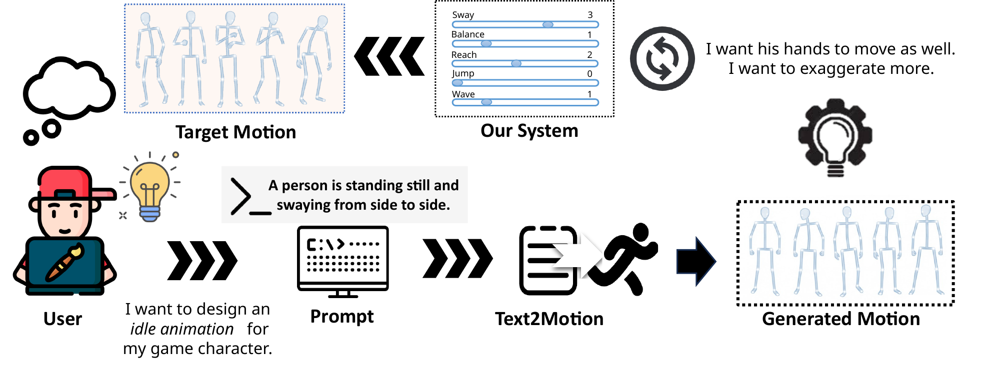

# CoMotion

CoMotion is a research system for interactive semantic steering of text-generated 3D human motion. Enter an English prompt, generate a baseline motion, and refine it with sliders for six prompt-relevant atomic actions. Compare the baseline and current motion in the browser and export either as an MP4 or NumPy array.

**CoMotion: A Real-Time System for User-Driven Semantic Steering in Text-to-Motion Generation**  
Zeyuan Fan and Chengshuo Xia · Guangzhou Institute of Technology, Xidian University  
PACMHCI, 2026 · [Paper](https://doi.org/10.1145/3859320) · [BibTeX](CITATION.bib)



_The diagram illustrates the generate-and-refine workflow. The web release shows six action controls._

## How it works

The backend encodes the prompt with CLIP and samples a motion-token sequence with a text-conditioned transformer. A VQ-VAE decodes the tokens into motion, which is reconstructed as a 22-joint skeleton and exported as MP4 and NumPy arrays.

CoMotion ranks a fixed vocabulary of atomic actions against the prompt and displays the six closest matches. Each slider accepts an integer from 0 to 5 and controls how many candidate codebook entries are selected for that action. During adjustment, the backend replaces a subset of tokens using prompt similarity and neighboring-token compatibility. Every adjustment starts from the session's original baseline, rather than accumulating edits. Slider values are steering parameters, not guaranteed action counts or calibrated motion intensities.

Our implementation builds on [T2M-GPT](https://github.com/Mael-zys/T2M-GPT).

## Setup

Use Python 3.8, Git, and an NVIDIA GPU with a driver compatible with CUDA 11.8. Clone the repository, enter its root, and create an isolated environment.

```bash
conda create -n comotion python=3.8 -y
conda activate comotion
python -m pip install torch==2.0.0 torchvision==0.15.1 --index-url https://download.pytorch.org/whl/cu118
python -m pip install -r requirements.txt
```

Git is required to install the pinned CLIP dependency. FFmpeg is supplied by `imageio-ffmpeg`; a separate system installation is not needed.

The commands below run from the repository root.

### Model resources

```bash
python tools/download_models.py
```

The downloader uses the [public pretrained model mirror](https://huggingface.co/vumichien/T2M-GPT/tree/e311a992ac49d0123aafc019b24150ed763b83a0), pins its revision, downloads in byte ranges where supported, and verifies SHA256 hashes. It places the files at:

```text
backend/pretrained/VQVAE/net_last.pth
backend/pretrained/VQTransformer_corruption05/net_best_fid.pth
backend/checkpoints/t2m/VQVAEV3_CB1024_CMT_H1024_NRES3/meta/mean.npy
backend/checkpoints/t2m/VQVAEV3_CB1024_CMT_H1024_NRES3/meta/std.npy
```

CLIP downloads its ViT-B/32 weights to `backend/clip_cache/` on the first start. Allow about 1.4 GB for downloaded model resources, plus space for generated results. Internet access is needed for installation and the first downloads; subsequent runs can reuse the cached files. Downloaded weights are not included in this repository.

### Start

```bash
python run.py --check
python run.py
```

Open [http://127.0.0.1:8000](http://127.0.0.1:8000) in your browser. The `--check` command checks the configuration, required model files, port availability, Python imports, and CUDA.

For a different port or storage location:

```bash
python run.py --port 8080 --data-dir ./results
```

Alternatively, copy `config.example.json` to `config.json`, edit it, and run `python run.py --config config.json`. Paths in a config file are resolved relative to that file. Without a config file, paths are relative to the repository root. The default model root is `backend/`. If you relocate it, use the same `--model-root PATH` with the downloader and launcher. The directory needs the model code (`models/`, `options/`, `utils/`, and `visualization/`) alongside the downloaded files.

## Use

1. Enter an English description, such as `A person walks forward and then waves their right hand.`
2. Click **Analyze**. The backend generates a baseline and retrieves six atomic actions.
3. Adjust one or more sliders, then click **Generate**.
4. Play **Baseline** and **Current** to compare the motions. Adjust the sliders and generate again as needed.
5. Click **Save Current** to hold a result in the third comparison panel. This selection lasts for the lifetime of the page.
6. Use **Download MP4** or **Download NPY** to keep a result. NPY files contain joint coordinates with shape `(1, frames, 22, 3)`.

**Retry** generates a new baseline for the last prompt. Outputs and session state are written under `data/` by default: `comotion.sqlite3`, `sessions/`, and `media/jobs/`. Restarting with the same data directory preserves the stored files; reloading the webpage starts a new browser session. The default 10 GiB data limit rejects new jobs once storage is full; it does not delete existing results automatically.


## Layout

```text
backend/comotion/       API, job queue, GPU worker, semantic steering
backend/models/         Motion transformer and VQ-VAE
backend/options/        Model configuration
backend/utils/          Motion reconstruction
backend/visualization/  Skeleton rendering
web/                   Browser interface
tools/download_models.py
run.py
config.example.json
requirements.txt
```

## Tests

```bash
python -m unittest discover -s tests -v
node --test web/tests/*.test.mjs
cd backend
python -m unittest discover -s tests -v
cd ..
```

Node.js is needed only for frontend tests. Unit tests use small fixtures; generating real motion requires the downloaded models and GPU.

## Citation

If you use CoMotion in research, please cite the [paper](https://doi.org/10.1145/3859320). Citation metadata is available in [BibTeX](CITATION.bib) and [Citation File Format](CITATION.cff).


See [NOTICE](NOTICE) for attribution and [licenses/](licenses/) for additional third-party license terms.
